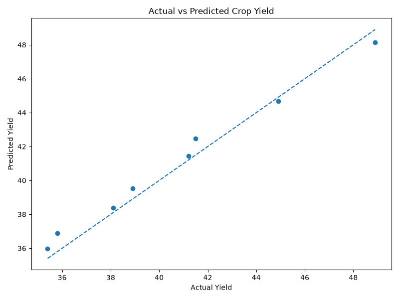

# 🌾 Crop Yield Prediction Using Multiple Linear Regression

A Machine Learning project that predicts **crop yield** using **Multiple Linear Regression** based on agricultural and environmental parameters.

The trained regression model is integrated with a **Flask web application**, allowing users to enter crop-related information and receive an estimated crop yield.

---

## 📌 Project Overview

Crop yield depends on several factors such as cultivated area, rainfall, temperature, fertilizer usage, irrigation, soil pH, and crop type.

This project uses **Multiple Linear Regression** to learn the relationship between these input features and crop yield.

### The project includes:

* Dataset loading and preprocessing
* Categorical feature encoding
* Training and testing data split
* Multiple Linear Regression
* Model evaluation using regression metrics
* Actual vs Predicted visualization
* Flask web application
* Real-time crop yield prediction

> **Note:** The dataset used in this project is a small synthetic/demo dataset created for academic demonstration. The reported metrics should not be interpreted as real-world agricultural prediction accuracy.

---

## 🧠 Multiple Linear Regression

Multiple Linear Regression is a supervised Machine Learning algorithm used to predict a **continuous numerical value** using multiple independent variables.

In this project, the model predicts:

**Target Variable:**

* Yield

**Input Features:**

* Crop
* Area
* Rainfall
* Temperature
* Fertilizer
* Irrigation
* Soil pH

The general equation of Multiple Linear Regression is:

```text
Y = b₀ + b₁X₁ + b₂X₂ + ... + bₙXₙ
```

Where:

* `Y` = Predicted crop yield
* `b₀` = Intercept
* `b₁ ... bₙ` = Regression coefficients
* `X₁ ... Xₙ` = Input features

Since `Crop` is a categorical feature, **One-Hot Encoding** is used to convert crop categories into numerical values before training the regression model.

---

## 🔄 Machine Learning Workflow

```text
Dataset
   ↓
Data Loading
   ↓
Feature Selection
   ↓
Categorical Encoding
   ↓
Train-Test Split
   ↓
Multiple Linear Regression
   ↓
Model Training
   ↓
Prediction
   ↓
Model Evaluation
   ↓
Flask Web Application
   ↓
Predicted Crop Yield
```

---

## 📊 Dataset Features

| Feature     | Description                    |
| ----------- | ------------------------------ |
| Crop        | Type of crop                   |
| Area        | Cultivated area in hectares    |
| Rainfall    | Rainfall in millimeters        |
| Temperature | Temperature in °C              |
| Fertilizer  | Fertilizer quantity in kg      |
| Irrigation  | Number of irrigation cycles    |
| Soil_pH     | Soil pH value                  |
| Yield       | Crop yield in quintals/hectare |

---

## 📈 Model Evaluation

The Multiple Linear Regression model was evaluated using the following regression metrics:

| Metric                         | Score |
| ------------------------------ | ----: |
| Mean Absolute Error (MAE)      |  0.60 |
| Mean Squared Error (MSE)       |  0.46 |
| Root Mean Squared Error (RMSE) |  0.68 |
| R² Score                       |  0.98 |

### Metric Explanation

**MAE — Mean Absolute Error**

Measures the average absolute difference between actual and predicted values. Lower values indicate better predictions.

**MSE — Mean Squared Error**

Measures the average squared difference between actual and predicted values. Lower values indicate better performance.

**RMSE — Root Mean Squared Error**

RMSE is the square root of MSE and represents prediction error in the same unit as the target variable.

**R² Score**

R² indicates how well the regression model explains the variation in the target variable. A value closer to 1 indicates a better fit.

---

## 📉 Actual vs Predicted Yield

The graph below compares the actual crop yield values with the values predicted by the Multiple Linear Regression model.



Points closer to the diagonal reference line indicate predictions closer to the actual values.

---

## 🌐 Web Application

The trained Machine Learning model is integrated with a Flask web application.

Users can enter:

* Crop type
* Area
* Rainfall
* Temperature
* Fertilizer quantity
* Irrigation frequency
* Soil pH

The application sends these values to the Flask backend, which uses the trained Multiple Linear Regression model to generate the predicted crop yield.

### Example Prediction

```text
Crop: Wheat
Area: 10 hectares
Rainfall: 650 mm
Temperature: 24 °C
Fertilizer: 120 kg
Irrigation: 3 times
Soil pH: 6.5

Predicted Yield: 42.33 quintals/hectare
```

---

## 🛠️ Technologies Used

### Machine Learning

* Python
* Pandas
* NumPy
* Scikit-learn
* Multiple
